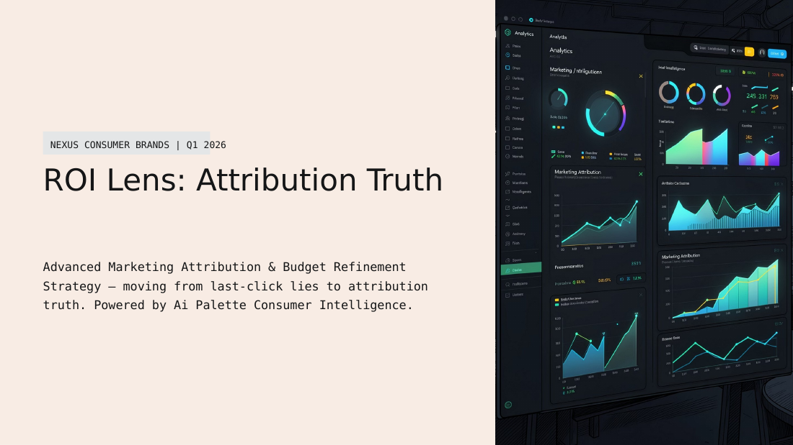
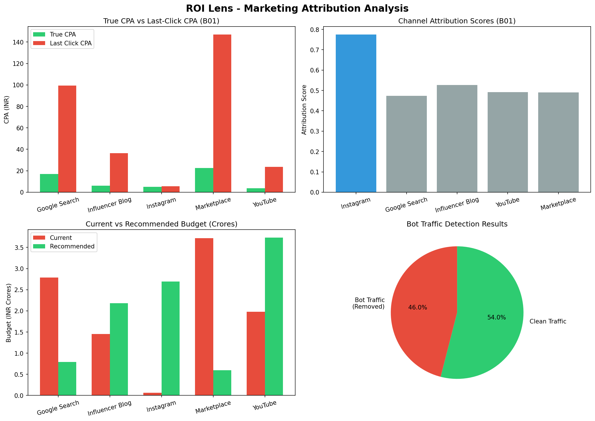
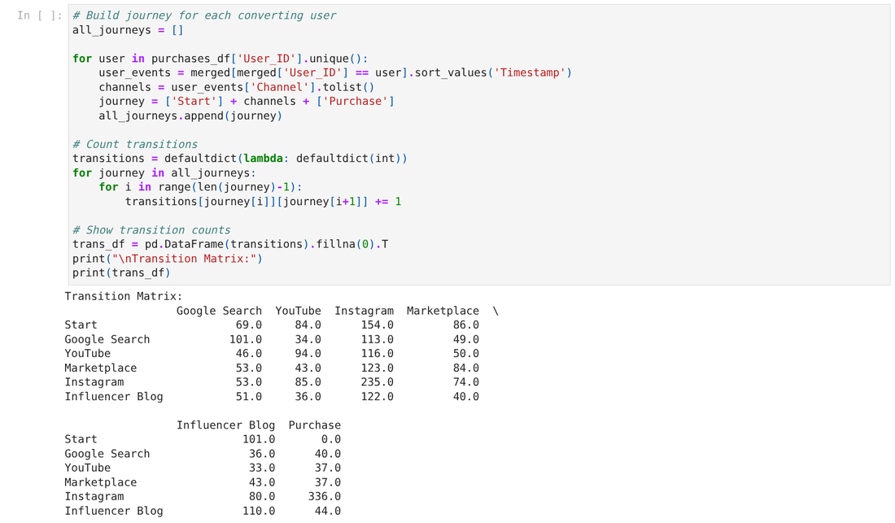
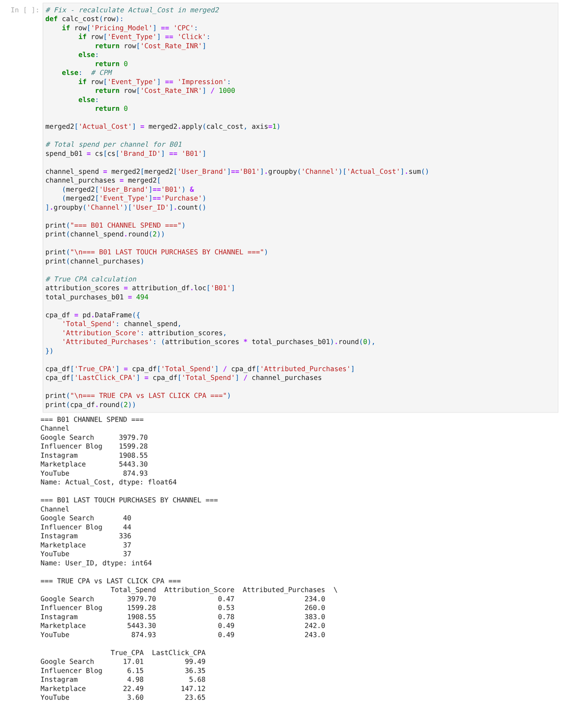
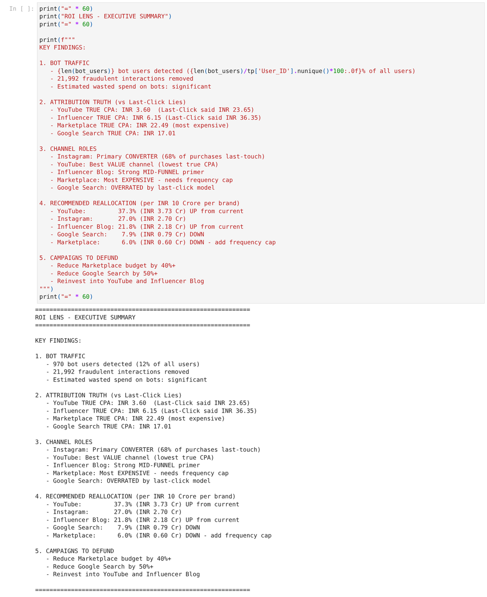
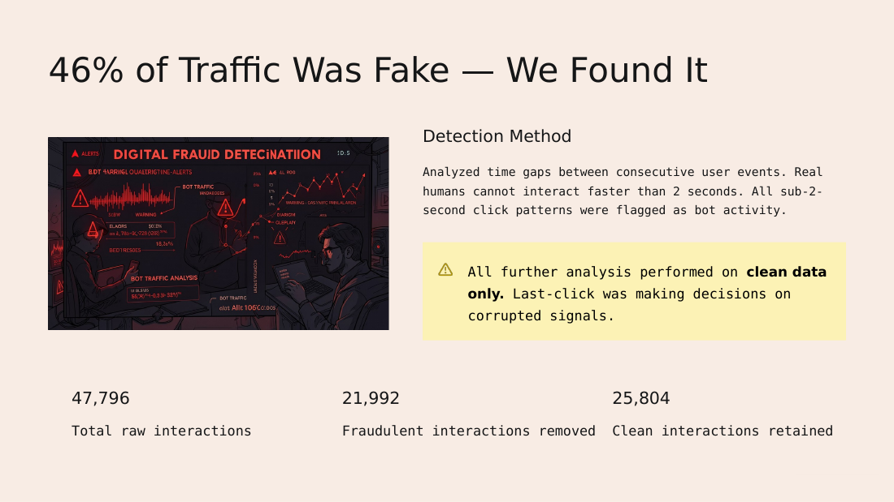
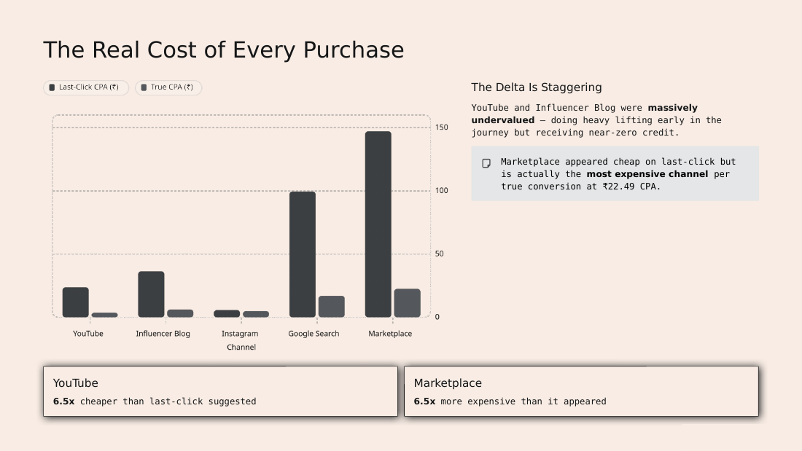
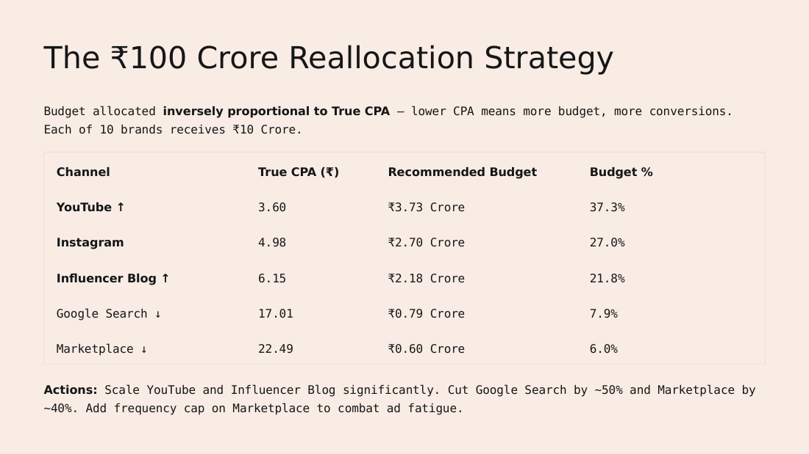

# ROI Lens: Attribution Truth

ROI Lens is a marketing-attribution analysis built as a Jupyter notebook. It answers a budgeting question: what does each channel really cost per purchase once you stop giving all the credit to the last click?

The notebook works on a Q1 2026 dataset of consumer touchpoints. It:

1. **Removes bot traffic.** Any user with two consecutive events less than 2 seconds apart is flagged as a bot.
2. **Rebuilds each buyer's journey.** Every user who purchased gets a `Start → channel → … → Purchase` path, and the notebook counts the transitions between channels.
3. **Scores each channel's attribution** and compares a journey-based **True CPA** against the **Last-Click CPA**.
4. **Reallocates a ₹10 Crore budget per brand** across the five channels, in proportion to 1 / True CPA.

The channels are Instagram, Google Search, Influencer Blog, YouTube and Marketplace.

The findings are also presented in a 10-slide deck, [`ROI-Lens-Attribution-Truth.pptx`](ROI-Lens-Attribution-Truth.pptx).



---

## Results



| Channel         | Attribution score | True CPA (₹) | Last-Click CPA (₹) | Recommended share of ₹10 Cr |
|-----------------|------------------:|-------------:|-------------------:|----------------------------:|
| YouTube         | 0.492             | 3.60         | 23.65              | 37.3 % (₹3.73 Cr)           |
| Instagram       | 0.775             | 4.98         | 5.68               | 27.0 % (₹2.70 Cr)           |
| Influencer Blog | 0.526             | 6.15         | 36.35              | 21.8 % (₹2.18 Cr)           |
| Google Search   | 0.474             | 17.01        | 99.49              | 7.9 % (₹0.79 Cr)            |
| Marketplace     | 0.490             | 22.49        | 147.12             | 6.0 % (₹0.60 Cr)            |

Bot filtering found 970 bot users and removed 21,992 of the 47,796 raw interactions (46 %). That left 25,804 clean interactions and 494 purchases. Of those purchases, 336 (68 %) had Instagram as the last touch.

### Notebook output

The transition counts between channels for the 494 converting journeys:



True CPA compared with Last-Click CPA for brand B01:



<details>
<summary>Executive summary cell</summary>



</details>

### Slide deck

| | |
|---|---|
|  |  |
|  | |

*The slides were rendered from the `.pptx` with LibreOffice, so their fonts may differ slightly from PowerPoint.*

---

## Data

The notebook reads three CSV files. **They aren't committed to this repository.** To rerun the notebook, place them next to `ROI.ipynb`.

| File                 | Rows   | Columns |
|----------------------|-------:|---------|
| `touchpoints.csv`    | 47,796 | `User_ID`, `Timestamp`, `Campaign_ID`, `Channel`, `Event_Type` (Impression / Click / Add-to-Cart / Purchase) |
| `user_profiles.csv`  | 88,163 | `User_ID`, `Segment`, `Trend_Affinity`, `Geography` |
| `campaign_spend.csv` | 50     | `Campaign_ID`, `Brand_ID`, `Channel`, `Pricing_Model` (CPC / CPM), `Cost_Rate_INR`, `Total_Budget_Allocated` |

## How the numbers are computed

- **Event cost.** A CPC campaign is charged `Cost_Rate_INR` for each click. A CPM campaign is charged `Cost_Rate_INR / 1000` for each impression. Every other event costs 0.
- **Attribution score** (`markov_attribution` in the notebook). This is the share of converting users whose journey includes the channel at least once.
- **True CPA.** Channel spend ÷ (attribution score × 494 purchases).
- **Last-Click CPA.** Channel spend ÷ purchases whose last touch was that channel.
- **Budget weights.** `w_c = (1 / TrueCPA_c) / Σ (1 / TrueCPA)`. Each weight is multiplied by ₹10 Crore per brand.

## Running it

The notebook was written in Google Colab; its first cell mounts Google Drive.

**In Colab:** open `ROI.ipynb`, upload the three CSVs (or put them in your Drive), then click *Runtime → Run all*.

**On your machine (Windows PowerShell):**

```powershell
py -m venv .venv
.\.venv\Scripts\Activate.ps1
pip install pandas numpy matplotlib seaborn jupyter
jupyter notebook ROI.ipynb
```

When running locally, skip the first cell (`from google.colab import drive`). Make sure the three CSVs are in the same folder as the notebook.

Running the notebook writes `roi_lens_analysis.png`, `b01_cpa_analysis.csv`, `all_brands_attribution.csv` and `budget_reallocation.csv`.

## Limitations

These follow directly from the code and are worth knowing before you reuse the numbers:

- **The attribution score is a touch rate, not a Markov removal effect.** `markov_attribution` builds the transition counts, but the score it returns is just the share of buyers' journeys that include the channel. The scores add up to about 2.76, not 1. As a result, "attributed purchases" total about 1,362 against 494 real ones. All True CPA values are therefore lower than a proper Markov or Shapley model would give. The ranking between channels is more meaningful than the absolute values.
- **Only brand B01 has touchpoints.** Every `User_ID` in the data belongs to B01. `campaign_spend.csv` lists 10 brands, but the "all 10 brands" table and the per-brand reallocation reuse B01's attribution scores for every brand.
- **The bot rule drops whole users.** If any two of a user's events are less than 2 seconds apart, all of that user's events are removed. That is 12 % of users but 46 % of events, so the rule may also remove some fast but real sessions.
- **Spend comes from logged events, not budgets.** CPA uses the cost of the events in the log (about ₹13.8 k for B01), while the reallocation applies the weights to a ₹10 Crore budget. Treat the CPAs as relative, not as real rupee costs per purchase.
- **The data isn't in the repo**, so the notebook can't be rerun from a fresh clone.

## Repository contents

| File                              | What it is |
|-----------------------------------|------------|
| `ROI.ipynb`                       | The analysis notebook, saved with its outputs |
| `roi_lens_analysis.png`           | The 4-panel summary chart produced by the notebook |
| `ROI-Lens-Attribution-Truth.pptx` | The 10-slide presentation of the findings |
| `docs/images/`                    | Screenshots used in this README |
